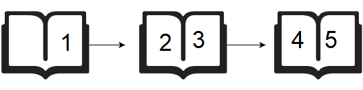

# Page Count Problem

`HackerRank`

<br>

## Problem Statement

A teacher asks the class to open their books to a page number. A student can either start turning pages from the **front** of the book or from the **back** of the book. They always turn pages **one at a time**.

- When they open the book, page `1` is always on the **right** side.
- When they flip page `1`, they see pages `2` and `3`.
- Each page except the last page is always printed on **both sides**.
- The last page may only be printed on the front, depending on the length of the book.

If the book is `n` pages long, and a student wants to turn to page `p`, what is the **minimum number of page turns** needed? They can start at the beginning or the end of the book.



Given `n` and `p`, find and print the minimum number of pages that must be turned in order to arrive at page `p`.

## Examples

**Example 1:**

```ini
Input: n = 6, p = 2
Output: 1
Explanation: From the front, one turn shows pages 2 and 3. From the back, the book opens on page 6, one turn shows pages 4 and 5, a second turn shows pages 2 and 3. The minimum is 1.
```

**Example 2:**

```ini
Input: n = 5, p = 4
Output: 0
Explanation: Opening from the back already shows pages 4 and 5. No turns are needed.
```

## Constraints

- `1 <= n <= 10^5`
- `1 <= p <= n`

<br><br>

## Approach

### The One Rule to Remember

Never count single pages. <mark>Count the open views (two facing pages you see at once). Page p lives in view number p // 2.</mark>

Write the book as a list of views:

```ini
View 0:        [ 1 ]
View 1:   [ 2 | 3 ]
View 2:   [ 4 | 5 ]
View 3:   [ 6 | 7 ]
...
```

- Every view holds one **even** page on the left and the next **odd** page on the right.
- Page `2` and page `3` are both in view `1`. Page `4` and page `5` are both in view `2`.
- So halving the page number (and dropping the decimal) gives its view: `p // 2`.
- **One page turn = move to the next view.**

### Turning From the Front

- You start at **view 0**.
- You want to reach **view `p // 2`**.
- Each turn moves you forward by one view.
- So the number of turns is simply: <mark>front = p // 2</mark>

### Turning From the Back

- You start at the **last view**, which is the view of the last page: `n // 2`.
- You want to reach **view `p // 2`**.
- Each turn moves you back by one view.
- So the number of turns is the gap between the two views: <mark>back = n // 2 - p // 2</mark>

> Why does `n // 2` always give the last view? If `n` is odd (say `5`), the last view is `[4 | 5]`, which is view `2`. If `n` is even (say `6`), page `6` sits alone on the left with an empty right side, which is view `3`. Both match `n // 2`.

### Pick the Shorter Side

- Compute both counts.
- Return the **smaller** one: `min(front, back)`.

> Memory hook: <mark>"Halve the page to find its view. Front is the view. Back is the gap to the last view. Take the smaller."</mark>

<br><br>

## Solution

```python
def pageCount(n, p):
    page_turns_from_front = p // 2
    page_turns_from_back = (n // 2) - page_turns_from_front

    return min(page_turns_from_front, page_turns_from_back)
```

<br><br>

## Dry Run

```ini
=====================================================
SCENARIO A: n = 6, p = 2
=====================================================

The book as views:

  View 0:        [ 1 ]
  View 1:   [ 2 | 3 ]     ← target page 2 is here
  View 2:   [ 4 | 5 ]
  View 3:   [ 6 |   ]     ← last view (page 6 alone on the left)

Step 1: Find the view of the target page.
  p // 2 = 2 // 2 = 1
  Page 2 lives in view 1.

Step 2: Turns from the front.
  page_turns_from_front = p // 2 = 1
  Check by hand: start at view 0 → turn 1 → view 1. Page 2 found.
  1 turn.

Step 3: Find the last view.
  n // 2 = 6 // 2 = 3
  The book ends at view 3.

Step 4: Turns from the back.
  page_turns_from_back = (n // 2) - page_turns_from_front
                       = 3 - 1
                       = 2
  Check by hand: start at view 3 → turn 1 → view 2 → turn 2 → view 1. Page 2 found.
  2 turns.

Step 5: Pick the smaller.
  min(1, 2) = 1

Return 1
Output: 1  ✓


=====================================================
SCENARIO B: n = 5, p = 4
=====================================================

The book as views:

  View 0:        [ 1 ]
  View 1:   [ 2 | 3 ]
  View 2:   [ 4 | 5 ]     ← target page 4 is here, and it is also the last view

Step 1: Find the view of the target page.
  p // 2 = 4 // 2 = 2
  Page 4 lives in view 2.

Step 2: Turns from the front.
  page_turns_from_front = p // 2 = 2
  Check by hand: view 0 → turn 1 → view 1 → turn 2 → view 2. Page 4 found.
  2 turns.

Step 3: Find the last view.
  n // 2 = 5 // 2 = 2   (2.5 drops the decimal and becomes 2)
  The book ends at view 2.

Step 4: Turns from the back.
  page_turns_from_back = (n // 2) - page_turns_from_front
                       = 2 - 2
                       = 0
  Check by hand: opening from the back already shows [4 | 5]. Page 4 is right there.
  0 turns.

Step 5: Pick the smaller.
  min(2, 0) = 0

Return 0
Output: 0  ✓


=====================================================
SCENARIO C: n = 6, p = 5  (the even-length trap)
=====================================================

The book as views:

  View 0:        [ 1 ]
  View 1:   [ 2 | 3 ]
  View 2:   [ 4 | 5 ]     ← target page 5 is here
  View 3:   [ 6 |   ]     ← last view

Why is this a trap?
  Page 5 is only one page away from page 6, so it is tempting to say 0 turns.
  But page 6 sits ALONE in its own view, so you must turn once to see page 5.

Step 1: Find the view of the target page.
  p // 2 = 5 // 2 = 2   (2.5 drops the decimal and becomes 2)
  Page 5 lives in view 2.

Step 2: Turns from the front.
  page_turns_from_front = p // 2 = 2
  Check by hand: view 0 → turn 1 → view 1 → turn 2 → view 2. Page 5 found.
  2 turns.

Step 3: Find the last view.
  n // 2 = 6 // 2 = 3
  The book ends at view 3.

Step 4: Turns from the back.
  page_turns_from_back = (n // 2) - page_turns_from_front
                       = 3 - 2
                       = 1
  Check by hand: start at view 3 [6 | ] → turn 1 → view 2 [4 | 5]. Page 5 found.
  1 turn.

Step 5: Pick the smaller.
  min(2, 1) = 1

Counting views (not pages) handled the trap automatically.
Return 1
Output: 1  ✓


=====================================================
SCENARIO D: n = 1, p = 1  (a one-page book)
=====================================================

The book as views:

  View 0:        [ 1 ]    ← target page, first view, and last view all at once

Step 1: Find the view of the target page.
  p // 2 = 1 // 2 = 0
  Page 1 lives in view 0.

Step 2: Turns from the front.
  page_turns_from_front = 0
  The book opens on page 1. No turns needed.

Step 3: Find the last view.
  n // 2 = 1 // 2 = 0
  The book ends at view 0.

Step 4: Turns from the back.
  page_turns_from_back = 0 - 0 = 0

Step 5: Pick the smaller.
  min(0, 0) = 0

Return 0
Output: 0  ✓
```

<br><br>

## Complexity Analysis

- **Time Complexity:** `O(1)`.
  - Only two divisions, one subtraction, and one `min`.
  - No loop, no matter how big the book is.
- **Space Complexity:** `O(1)`.
  - Only two variables (`page_turns_from_front`, `page_turns_from_back`) are used.

<br><br>

## Related Problems

- [Distance Between Bus Stops (1184)](https://leetcode.com/problems/distance-between-bus-stops/)
- [Minimum Time to Type Word Using Special Typewriter (1974)](https://leetcode.com/problems/minimum-time-to-type-word-using-special-typewriter/)
- [Shortest Distance to Target String in a Circular Array (2515)](https://leetcode.com/problems/shortest-distance-to-target-string-in-a-circular-array/)
- [Count Odd Numbers in an Interval Range (1523)](https://leetcode.com/problems/count-odd-numbers-in-an-interval-range/)
- [Pass the Pillow (2582)](https://leetcode.com/problems/pass-the-pillow/)
- [Minimum Time Visiting All Points (1266)](https://leetcode.com/problems/minimum-time-visiting-all-points/)
